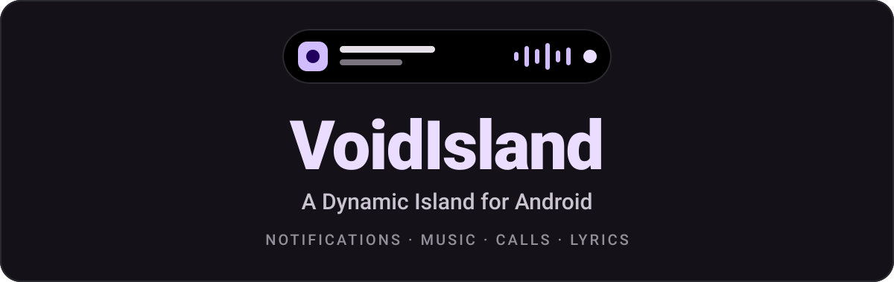

<div align="center">



<br>

[](LICENSE)
[](#-install)
[](#-compatibility)
[](src)
[](#-build-from-source)
[](https://github.com/vxyzview/VoidIsland/releases)
[](https://github.com/vxyzview/VoidIsland/actions)

**Notifications, music, calls and live activities on a floating island.**<br>
Pure black, Material You accent, private by design.

[**Install**](#-install) &nbsp;·&nbsp; [**Features**](#-features) &nbsp;·&nbsp; [**Privacy**](#-privacy) &nbsp;·&nbsp; [**Build**](#-build-from-source) &nbsp;·&nbsp; [**Contribute**](#-contributing)

</div>

<br>

<!-- Tip: add screenshots in assets/ and show them here, e.g.  -->

## ✨ Highlights

| | |
| :-- | :-- |
| 🔔 **Banners** | Messages, calls, payments, timers, navigation and downloads, all on one island. |
| 💬 **Quick reply** | Answer a chat from the banner. The reply box grows out of it as one black shape. |
| 🎵 **Music and lyrics** | 8 compact and 8 expanded music styles, with synced lyrics sliding along the pill. |
| 🕒 **Idle clock** | 10 compact and 8 expanded clock styles for when nothing is happening. |
| 🔒 **Lock-screen privacy** | Follows what Android's own lock screen would show. Secret notifications never appear. |
| 🚗 **Live activities** | Rides, food delivery and live scores stay on the island while they run. |
| 🎨 **Material You** | The accent follows your wallpaper while the island itself stays pure black. |
| 🔋 **Light on battery** | Quiet with the screen off, bounded caches, no idle threads. |

<br>

## 📲 Install

1. Download the APK from [**Releases**](https://github.com/vxyzview/VoidIsland/releases) and sideload it (**Android 8+ / API 26+**). Each release also has a `.sha256` file to check the download against. To get updates without the app ever touching the network, add the repository to [Obtainium](https://github.com/ImranR98/Obtainium): it reads the Releases page for you.
2. Turn on the two things VoidIsland asks for:
   - **Accessibility** service: draws the island and sees the shade.
   - **Notification access**: reads notifications and music.
3. On **Android 13+**, a sideloaded app first needs *App info > ⋮ > Allow restricted settings*, otherwise those two switches stay greyed out.

> [!TIP]
> Some phone makers close background apps and the island disappears. See [Keeping it running](#-keeping-it-running).

<br>

## 🧩 Features

### 🔔 Banners, rules and quick reply

- **Quick reply**: expand a message banner and tap *Reply* to answer without opening the app. The box grows out of the banner's bottom edge as part of the same black shape (same width, corner radius and border, no seam), with a rounded text field, a cancel button and a round send button in the island's accent.
  - While it is open the banner is held: it does not time out and no newer banner replaces it.
  - Banner and box leave together when the reply is sent (the arrow turns into a tick first), or when you cancel (cancel button, back, tap outside, swipe the banner up), press another button, or tap the banner to open the app.
  - A banner you give up on carries on as a normal one for a few more seconds. A forgotten box lets go after 3 minutes without typing.
- **Island rules**: quiet hours (optionally only for chosen apps), mute group chats, one banner per chat.
- **Live activities**: rides, food delivery and live scores stay on the island while they run. Missing an app? Add it under **Apps > Ride / Food / Score apps**.
- **Hides only when it should**: the island stays visible everywhere, landscape included, and steps aside only while an app is fullscreen (video, game, reader: anything that hides the status bar). Turn that off under **Behavior > Rules**. The idle clock can also stay visible inside apps (turn off *Hide idle clock in apps*) and still disappears in fullscreen.

<details>
<summary><b>🫥 Only on the island</b> (opt-in, off by default): remove the original from the shade</summary>

<br>

Messages and payments shown on the island are removed from the shade. Apps on the *Keep in shade* list keep theirs.

- An original is only removed once the island has **really put that banner on screen** (not when it is merely queued). If the island is off, hidden (fullscreen app, lock screen, shade open) or ignoring the app, the notification stays in the shade.
- Android also tells the app that its notification was dismissed, so some apps may mark that message as read.
- Ongoing notifications cannot be removed by a listener at all.
- The system's own pop-up can still flash for a moment before the original is removed. To stop it completely, open **Rules > Stock pop-up**, pick the app and switch off *Pop on screen* in Android's notification settings (the notification itself must stay on, the island reads it).
- Android cannot bring back a notification that was already removed, so a banner you look away from would be gone. **Behavior > Help > Recent banners** keeps the last 20 banners the island showed (in memory only) and opens the app when you tap one.

</details>

<details>
<summary><b>🔒 Lock-screen privacy</b></summary>

<br>

While the phone is locked behind a PIN, pattern or password, the island follows what Android's own lock screen would show.

| Notification | On the island while locked |
| :-- | :-- |
| Marked *secret* (banks, one-time codes, password managers) | Never appears |
| *Private*, with *Hide sensitive content* on | App name and "Content hidden". No text, no amount, no buttons, no reply |
| Anything else | Shown as usual |

This covers message and payment banners **and** the live pills for navigation, timers, downloads, rides and orders. A live pill that is hidden or redacted while locked comes back in full after you unlock. Calls and music keep Android's own lock-screen behaviour.

A banner that was hidden or redacted is **never removed from the shade**. A plain swipe-to-unlock lock hides nothing, same as the system.

</details>

### 🎵 Music and lyrics

- **Lyrics** on the music pill: one line at a time. Long lines slide sideways in step with the song (pause, seek and all).
- The seek bar can be dragged, and the lyric nudge under **Behavior** applies to every style.
- Nothing animates while the song is paused or the display is off.
- Every design follows the accent (Material You or custom).

<details>
<summary><b>🎛️ Music styles</b>: pick one under <i>Style > Music</i></summary>

<br>

The island shows the new look right away, with the demo song if nothing is playing.

**Compact pill (8)**

| Style | Look |
| :-- | :-- |
| Classic | Round-cornered art, the lyric line or four bars |
| Vinyl | A little record that spins while the song plays |
| Ring | Round art inside a ring that fills as the song goes on |
| Wave | Round art and a wide rolling waveform. The lyric line takes its place when the song has one |
| Song | Title and artist instead of lyrics, and no lyric lookups at all |
| Track | Title with a slim progress line under it and a play / pause badge |
| Beat | Title and artist with a tonal capsule holding a dot-matrix equalizer |
| Timer | Round art, the title and a capsule with the time left |

**Expanded card (8)**

| Style | Look |
| :-- | :-- |
| Classic | The familiar card |
| Vinyl | A record under a tonearm that lowers when the song plays and lifts when it pauses |
| Poster | Big centred art in a soft accent frame |
| Mini | One slim row with a thin seek bar, the shortest card |
| Lyrics | The previous, current and next line in the middle of the card |
| Bento | Big art beside a tonal title tile, then three roomy flat keys with an accent play key |
| Wave | A rolling waveform across the card |
| Cover | Wide art with the title on a flat chip and an equalizer badge |

Track, Beat, Timer, Bento, Wave and Cover are strictly **flat**: solid fills and thin lines, no gradients.

</details>

<details>
<summary><b>🕒 Idle clock styles</b>: pick one under <i>Style > Idle clock</i></summary>

<br>

**Compact pill (10)**

| Style | Look |
| :-- | :-- |
| Dial | Mini dial whose ring fills with the minutes, plus time and date |
| Center | Just the time, with a small AM / PM |
| Split | Hour left, minutes right, a camera hole in between |
| Date | Day on the left, time on the right |
| Line | Centred time over a slim line whose round head travels the hour. Always drawn, the text shrinks to fit short pills |
| Capsule | The time in a filled accent capsule |
| Sky | A sun, sinking sun or moon for the part of the day, plus the time |
| Aura | Digits that fade from your accent into white |
| Dots | The week as seven dots with today lit, plus the time |
| Beacon | A glowing lamp inside a ring that fills with the day, a softly glowing time and how much of the day has gone |

**Expanded card (8)**

| Style | Look |
| :-- | :-- |
| Classic · Digital · Analog · Bold · Week | The everyday set |
| Rings | Three activity rings for the day, the hour and the minute |
| Flip | A flip clock with a seconds line |
| Horizon | The sun, or the moon at night, travelling an arc over the time |

</details>

### 🎨 Activity designs
Every activity (call, payment, charging, download, timer, device, navigation, live activity, message) picks its own **compact pill** and **expanded card** under *Style > Activities*. *Classic* is the original; the new ones are **flat** (solid fills, tonal tiles and thin lines, no gradients, no glow) and follow your accent, text size and lock-screen rules.

| Compact pill | Expanded card |
|---|---|
| **Capsule**: a tonal icon tile and a filled accent capsule with the number | **Bento**: a big icon tile beside the title tile, a number tile with a progress line, roomy keys |
| **Track**: icon, title over a slim progress line, number | **Hero**: one big centred number (a battery, a check or a photo above it) |
| **Focus**: the number, centred and bold | **Strip**: one slim row, the shortest card |
| **Signal**: icon plus a live gauge (voice bars, battery cells, a ring, pulsing dots) | **Stats**: up to four tiles of facts: speed, time left, temperature, duration... |

Payments and messages are banners (they open as a card and leave), so they only have expanded designs. *Use these on every activity* applies the chosen pair everywhere.

New with it:
- **Call**: an ongoing call shows up to three of the app's buttons (Hang up, Speaker, Mute); the Stats card shows status, duration and app.
- **Payment**: *Copy amount* and *Open* keys; status (sent / received / failed) and merchant tiles.
- **Charging**: charger kind (Fast / AC / USB / Wireless), power in watts, temperature and time to full. *Keep charging on the island* (Behavior) leaves a live charging pill while a charger is connected.
- **Download**: the app's own Pause / Cancel buttons, plus elapsed time and an estimate of the time left from the download's own pace.
- **Timer**: a ring that runs down (or a lap ring on a stopwatch), end time and total length.
- **Headset / Bluetooth**: icons by device type (headphones, speaker, phone, watch). *Keep audio devices on the island* shows the connected headphones, speaker or car as a pill.
- **Phone events**: airplane mode pop-up, and an optional volume bar (off by default).

### 🌍 Everything else

- **Material You accent on a black island**: on Android 12+ the accent follows your wallpaper colours by default (play button, seek and progress bars, rings, action buttons, glyphs, in both the compact pill and the expanded card) while the island itself stays pure black. Change it at **Style > Colors > Accent**: *Auto* (album-art / app colour), *Material You* or *Custom*.
  <br>It follows the Material 3 dark-scheme roles: primary for the accent and filled buttons, secondary container for tonal buttons, tertiary for "good" things (accept, success, charging), error for "bad" ones (decline, low battery), and on-surface tones for text and tiles.
- **Backup**: **Apps > Backup** saves every setting to a text file and restores it after a reinstall or on a new phone. A restore asks first, only sets settings this version knows (anything else in the file is ignored) and changes nothing if the file has none.
- **Languages**: the text the island itself shows (banner buttons, call and payment titles, battery / ringer / Bluetooth pop-ups, the reply box) is translated into **English** and **Bahasa Indonesia**. Settings screens are still English. Add a language by copying `res/values/strings.xml` to `res/values-xx/`. Banners are announced by TalkBack.
- **One-time codes**: a notification with a 4 to 8 digit code next to a word like *code*, *OTP* or *kode* gets a **Copy code** button first. The copy is marked sensitive on Android 13+ so it stays out of the clipboard preview, and the button is never shown while the lock screen hides content.
- **Why didn't it show?**: **Behavior > Help > Why didn't it show?** lists the last banners the island kept off the screen and the reason (app switched off, silent channel, quiet hours, you were in that app, full-screen app, queue full...), with where to change it. It holds app names and reason codes only, never message text, in memory only.
- **Why did the island stop?**: on Android 11+, **Behavior > Help > Why did the island stop?** shows how Android ended VoidIsland the last few times (low memory, battery limits, a crash, a Force stop) and what to do about it.
- **Android 16 live updates**: an ongoing notification that Android promoted to a live update (or that uses `Notification.ProgressStyle`) appears as a live activity even when the app is not on the ride / food / score lists.
- **App picker search**: every app list has a search box and *Turn all on / off* for the apps the search shows.
- **TalkBack**: the island's swipes are offered as accessibility actions (Dismiss, Expand, Next / Previous activity), and a double-tap opens it.
- **Diagnostic log**: **Behavior > Help > Diagnostic log** lists the last errors the island caught (where and what kind, never any message text) with a *Copy* button for bug reports. Memory only, gone when the process ends.
- **Animations**: the island follows Android's animation settings (*Developer options > Animator duration scale*, and *Remove animations* in accessibility). A faster or slower scale speeds up or slows down the springs, and scale 0 makes the island jump straight to its next shape.

<br>

## 🛡️ Keeping it running

Some phone makers (Xiaomi / Redmi / Poco, Oppo / Realme / OnePlus, Vivo, Huawei / Honor, Samsung, Asus) close background apps to save battery, and then the island disappears.

- On those phones the app shows a one-time hint after setup, and **Home > Setup** gets an *Autostart & background* item that opens the maker's own screen when it can (otherwise the app info page).
- Also set **Battery: unrestricted** (it turns into a tick once the system agrees).
- Those screens are private to each ROM and change between versions. If the button does not land on the right page, open *Settings > Apps > VoidIsland* and allow autostart / background activity there.

<br>

## 🔐 Privacy

> [!IMPORTANT]
> Notification text, replies, the Recent banners list and the diagnostic log **stay on the phone**. None of it is ever sent anywhere, written to storage or included in a backup (a backup holds settings only).

The app's **only** network use is the lyric lookup, and it can be switched off.

| | |
| :-- | :-- |
| **Service** | [LRCLIB](https://lrclib.net): open, community-run, no account or key |
| **Sent, per new song** | Song title, artist and length (as shown by your music player), plus the app name in the `User-Agent` |
| **Never sent** | Anything else |
| **Stored** | Nothing. Lyrics are not bundled and never written to storage. They live in memory for the current session only (up to 40 songs) |
| **Turn off** | **Behavior > Music lyrics**. No lookups are made after that |
| **Where the code is** | One small file: [`LyricsNet.java`](src/com/vxyzview/voidisland/LyricsNet.java) |

The first time the app opens it shows this in a short notice with *Keep on* / *Turn off*. The lyrics belong to their rights holders, and LRCLIB's own terms apply to the service: check them before reusing or redistributing anything you see.

<br>

## 🔋 Battery and memory

The island is a long-lived process, so idle cost matters more than peak speed.

- **Display off = quiet.** The once-a-minute clock broadcast is only registered while the screen is on, the equalizer bars stop redrawing, and the music card skips updates (it catches up the moment the screen lights up). Timers stop while the screen is off.
- **Low frame rates, only when visible.** Equalizer bars redraw at about 20 fps and only while visible, playing and the display is on. The spinning record (about 25 fps) and the waveforms (about 20 fps) follow the same rule, and a paused record draws once and sleeps.
- **Calm lyrics.** The compact music pill with lyrics ticks once a second. The lyric view schedules its own line changes and slide, and a seek or pause re-anchors it immediately.
- **Fewer lookups.** Songs LRCLIB has no lyrics for (and video / podcast apps) are not asked about again for an hour. A song the exact lookup misses is searched again by artist + title and by its cleaned-up title (no "feat." / "Remastered"), accepted only when its length fits.
- **Bounded caches.** App icons (about 2 MB) and album artwork (about 1 MB) are limited by size, not by count. Lyrics keep the last 40 songs.
- **Memory pressure.** Both services release icons, artwork and most cached lyrics when Android reports a real shortage. Everything refills on demand.
- **No idle threads.** The two lyric-lookup workers exit after 20 s without work.
- **No redundant image work.** A repeated artwork refresh does not re-scale the picture, re-read its colour or re-upload its texture.

<br>

## 🧪 Compatibility

Built for **Android 8+ (API 26)**, targeting **API 34**.

- Android 14+ restricts background activity starts. The island opts in when it sends a notification's own intents.
- Android 13+ greys out accessibility and notification access for sideloaded apps until *Allow restricted settings* is ticked.
- Raising the target to 35 turns on forced edge-to-edge for the settings screens and the reply box, so it needs its own pass.
- Before a release, walk through [`TESTING.md`](TESTING.md) on at least one **Android 12** and one **Android 14+** phone.

<br>

## 🛠️ Build from source

You need a JDK, an `android.jar` (API 34) at `libs/android-34.jar`, and `aapt` + `d8` (or `dx`) + `apksigner` + `zipalign`. Then:

```sh
./build.sh
```

> [!WARNING]
> The signing key is **not** included in the repo and there is no built-in password. On first run `build.sh` creates `void.jks` with a random password saved in `void.jks.pass` (both git-ignored). **Back both up**: losing them means users must uninstall to update.

<details>
<summary><b>More about signing</b></summary>

<br>

- Later runs read the password from `$KS_PASS` or from `void.jks.pass`.
- A `void.jks` made by an older `build.sh` used the password `voidisland`. Run `KS_PASS=voidisland ./build.sh` once (or put that word in `void.jks.pass`) and rotate the key when you can.
- The password goes to `keytool` / `apksigner` through the environment, never on a command line.
- CI signs with the keystore kept in the `SIGNING_KEYSTORE` repository secret (base64 of `void.jks`) and its password in `SIGNING_KEYSTORE_PASSWORD`. **Both are required: without them the workflow stops** instead of publishing an APK signed with a throwaway key that nobody could update over. Your locally generated key differs from the CI one unless you upload the same file.

</details>

### 🚀 Releases via GitHub Actions

The **Build APK** workflow builds, tests and signs on every trigger.

| Trigger | Result |
| :-- | :-- |
| Push a tag `v1.2` | Stable, attached to a regular **Release** |
| Push a tag `v1.2-beta.1` / `v1.2-alpha.1` | Pre-release |
| **Run workflow** (Actions tab), pick `beta` / `alpha` / `stable` | beta and alpha become pre-releases. stable bumps the next patch from the latest tag |

`versionCode` is a monotonic build number (10 × commit count, pre-releases 5 points below). `versionName` comes from the tag.

### ✅ Tests

Unit checks for the pure-Java logic live in [`test/`](test), one class per area (`ParseCheck`, `LyricsCheck`, `BackupCheck`, `PrivacyCheck` for the lock-screen rules, `ClassifierCheck` for which notifications get a banner, and so on). `Check` runs them all. Logic that has to be testable is kept free of Android types (`Privacy`, `Gate`, `Dedupe`, `Rules`, `Backup`, `Lyrics`, `Trace`, `AppFilter`, `ExitReason`...). CI runs them on every push and pull request (the **CI** workflow, no secrets needed) and again before every release. A few checks (`IslandEventCheck`) touch Android types and need `android.jar` on the classpath; without it they are skipped, not failed. Locally, after building:

```sh
AJ="$ANDROID_HOME/platforms/android-34/android.jar"   # or libs/android-34.jar
javac -d out/test -cp "out/classes:$AJ" $(find test -name '*.java')
java -cp "out/test:out/classes:$AJ" com.vxyzview.voidisland.Check
```

To add an area, write `XCheck.run()` (use `import static com.vxyzview.voidisland.Check.ok;`) and list it in `Check.main`.

<br>

## 🤝 Contributing

Bug reports, translations, new styles and fixes are welcome. Start with [**CONTRIBUTING.md**](CONTRIBUTING.md) and please follow the [Code of Conduct](CODE_OF_CONDUCT.md). Found a security problem? See [**SECURITY.md**](SECURITY.md) and report it privately.

## 📄 License

VoidIsland is released under the [**MIT License**](LICENSE). © 2026 [vxyzview](https://github.com/vxyzview)

Lyrics come from [LRCLIB](https://lrclib.net) and belong to their rights holders.

<br>

<div align="center">

Made by [**vxyzview**](https://github.com/vxyzview)

</div>
